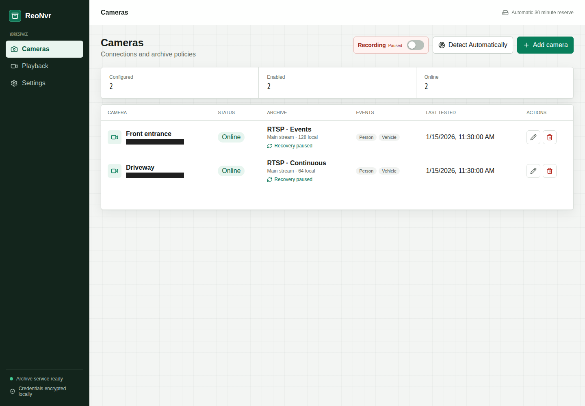
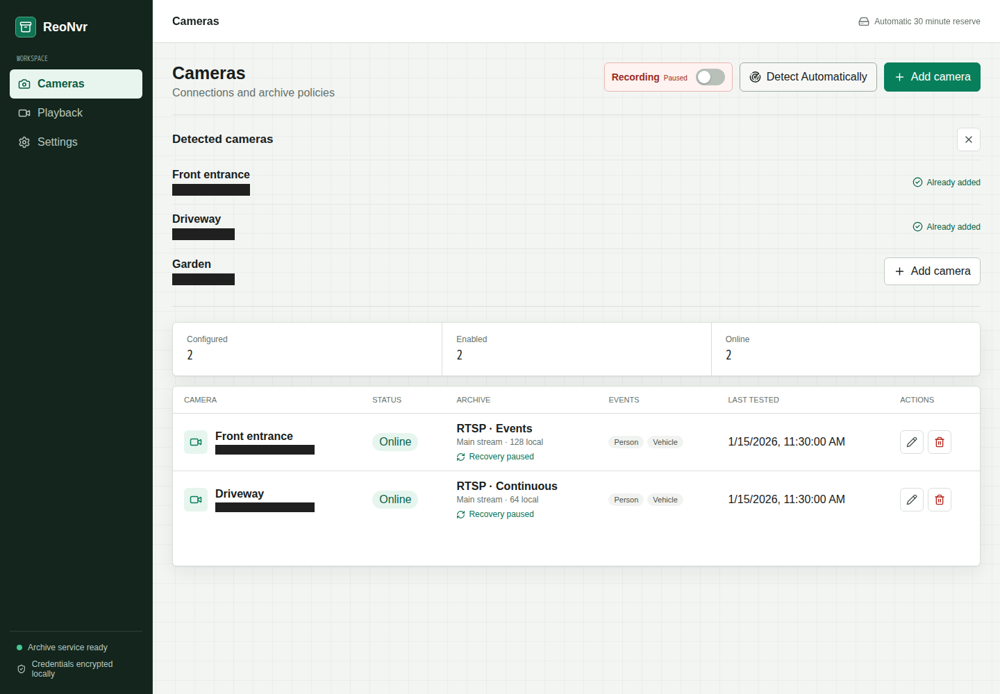
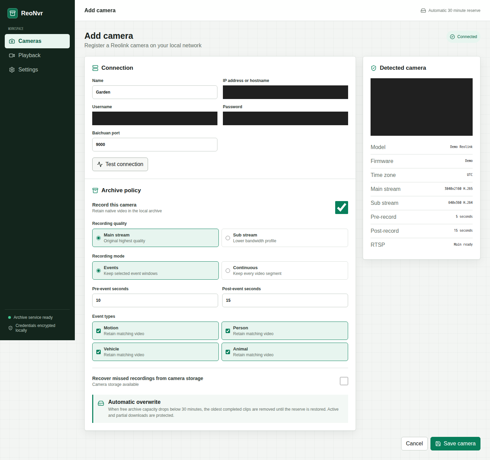

# ReoNvr

ReoNvr is a self-hosted recording archive for Reolink cameras. It records native
RTSP streams, recovers missed footage from camera storage when available, and
provides a browser interface for cameras, detections, and local playback.
It does not transcode video or change camera recording schedules, streaming
settings, detection rules, storage, or time settings. It never deletes camera
SD-card media.

## Requirements

- Docker Engine with Docker Compose v2 on Linux, or Docker Desktop running Linux
  containers on Windows/macOS.
- A Linux amd64 or arm64 Docker server. Intel/AMD PCs normally use amd64; Apple
  Silicon and ARM64 Linux devices use arm64. Check with:

  ```sh
  docker info --format '{{.Architecture}}'
  ```

- A reachable Reolink camera with an account allowed to read device information,
  events, recordings, and RTSP streams. Enable the required camera services in
  the Reolink application yourself if they are unavailable.
- Enough disk space for the archive and a browser capable of decoding the
  selected native camera codec. HEVC/H.265 playback depends on the browser and
  operating system; selecting an available H.264 sub-stream can improve
  compatibility without transcoding.

## Download and Install

1. Open [Releases](https://github.com/Jebarson/ReoNvr/releases) and download the
   ZIP for your Docker server architecture, for example
   `ReoNvr-v1.0.0-linux-amd64.zip` or `ReoNvr-v1.0.0-linux-arm64.zip`.
   Releases currently inherit this private repository's access restrictions.
   An authorized maintainer can also share the ZIP directly; running it needs
   no GitHub account, source checkout, compiler, or registry credentials.
2. Verify the downloaded ZIP against its accompanying `.sha256` file and extract
   it into a dedicated folder. The ZIP contains all three Docker images, Compose
   configuration, startup scripts, checksums, and version metadata.
3. Optionally edit the extracted `.env` before first startup. Keep
   `REONVR_VERSION` and `REONVR_ARCH` unchanged. The defaults use Docker-managed
   persistent volumes and expose the web interface only on this computer.
4. Start Docker, then run the appropriate script from the extracted folder.

   Windows PowerShell:

   ```powershell
   .\start.ps1
   ```

   Linux/macOS shell:

   ```sh
   sh ./start.sh
   ```

   The scripts verify bundled file checksums, check the Docker architecture,
   import the images, and wait for application and gateway health checks.
   The editable `.env` is intentionally excluded from the internal checksums.
5. Open <http://localhost:8080>, or the HTTP port configured in `.env`.

After the ZIP is downloaded, installation does not pull images or install
dependencies from the internet. Camera access still requires connectivity from
Docker to your camera network. The gateway is private to the Compose network.

## First Camera

The screenshots below use illustrative demo data. Camera addresses, credentials,
and camera images are covered with solid privacy masks.



### Detect Automatically

1. Open **Cameras** and choose **Detect Automatically**. ReoNvr scans for
   reachable Reolink devices and lists them under **Detected cameras**.
2. Choose **Add camera** beside the device you want. Its name, address, and native
   port are filled in for you. Devices already registered show **Already added**.
3. Enter the camera credentials, select the stream, and choose **Test connection**.
   Review its capabilities and recording options, then save it as described below.



Detection does not add cameras, supply credentials, or enable recording by
itself. It does not change camera settings. If a device is not found, add its
address manually instead.

For Docker hosts with suitable LAN networking, enable the optional discovery
relay from the extracted release folder:

```sh
docker compose --profile discovery up -d --wait
```

The relay uses host networking and UDP `2000`; the app receives replies on UDP
`3000` (or `REONVR_DISCOVERY_PORT` on the host). Camera discovery needs broadcast
reachability and may not cross subnets, VPNs, or Docker Desktop's Linux VM.
Use manual registration when it cannot reach the camera LAN. ReoNvr does not
change Docker Desktop, firewall, or camera configuration automatically.

### Add Manually and Configure Recording

1. Open **Cameras**, choose **Add camera**, and enter its name, LAN address, and
   camera credentials. Skip entering the address if you selected a detected
   device. There are no default camera credentials.
2. Select the stream quality and choose **Test connection**. ReoNvr reads the
   model, clock information, streams, events, and storage/search capabilities.
   Changing stream quality requires another connection test.
3. Select **Events** to retain footage around selected detections, or
   **Continuous** to keep every stream-copy segment. Optionally enable
   **Recover missed recordings from camera storage** when the connection test
   confirms usable camera storage and recording search.
4. Save the camera. In **Settings**, select the archive subfolder, folder layout,
   and retention policy. The archive subfolder is relative to `/archive`.
5. Enable the application-wide **Recording** switch when recording should run.
   Disable it to pause ingestion across all cameras.



Recovery fills monitored missing intervals, not the camera's entire history. It
can only recover footage the camera actually recorded and still retains. Keep
camera and host clocks synchronized yourself. Playback shows locally verified
archived media, not camera-only search results. A discovered event is
not proof that its video has been archived.

### Automatic Event Detection

ReoNvr reads the camera's native detections, such as **Motion**, **Person**,
**Vehicle**, and **Animal**, according to that model's capabilities. It does not
run a separate AI detector or change the camera's detection rules. Select the
event types you want while configuring the camera. With recording enabled,
**Events** mode retains footage around those detections; **Continuous** mode
retains all footage. Use **Playback** and its event-type filters to find local
video for those detections. Enable the desired detection features in the Reolink
application yourself if the camera is not reporting them.

## Configuration

Edit `.env`, then apply changes with `docker compose up -d --wait`.

| Setting | Default | Purpose |
|---|---|---|
| `REONVR_HTTP_PORT` | `8080` | Host web port |
| `REONVR_BIND_ADDRESS` | `127.0.0.1` | Host interface exposing the web UI |
| `REONVR_DISCOVERY_PORT` | `3000` | Host UDP port for discovery replies |
| `REONVR_RECORDINGS_PATH` | Docker volume | Optional absolute host archive directory |
| `COMPOSE_PROJECT_NAME` | `reonvr` | Persistent installation identity |

To store recordings in a host folder, set `REONVR_RECORDINGS_PATH` to an existing
absolute path such as `/srv/reonvr/recordings` or `D:/ReoNvr/recordings`. On Linux,
the container user (UID/GID `10001`) needs write access. ReoNvr does not change host
folder ownership automatically. Changing this mount does not move existing
recordings; preserve the old archive and plan a deliberate migration.

**Do not expose ReoNvr directly to the internet.** The application does not supply
an internet-facing authentication/TLS boundary. Keep loopback binding, or use a
trusted network and an authenticated HTTPS reverse proxy. Camera credentials
are encrypted at rest, but that does not make an exposed web interface safe.

## Operation and Backups

Run these commands from the extracted release folder:

```sh
docker compose ps
docker compose logs --tail=100 app gateway
docker compose stop
docker compose start
```

Docker-managed volumes persist the database, encryption key, gateway state, and
archive across container recreation. Keep the same `COMPOSE_PROJECT_NAME` across
upgrades. **Never run `docker compose down -v` on an installation you want to
keep**: it deletes named volumes, including the encryption key and recordings.

Before a backup, pause recording in the UI and stop the stack. Back up `.env`
and the data, secrets, gateway, and archive volumes together, or the configured
host archive folder instead of the archive volume. `docker compose config
--volumes` lists the named volumes. Store backups securely: database and key
backups together can decrypt saved camera credentials. Losing the master key
makes saved credentials unusable. Start the stack again when the backup finishes.

## Upgrading

1. Read the new release notes, pause recording, stop the old stack, and take a
   consistent backup of its configuration, data, key, and archive.
2. Extract the new matching-architecture ZIP into a new folder. Transfer your
   customized settings from the previous `.env`, but retain the **new**
   `REONVR_VERSION` and `REONVR_ARCH`. Keep the old project name and archive path.
3. Run the new startup script, check `docker compose ps`, and verify cameras,
   recordings, playback, and recording controls before resuming ingestion.

Database migrations run automatically. Do not start an older image against a
newer database unless its release notes explicitly allow it. Rollback may require
restoring the matching database, key, configuration, and archive backup.
Source-checkout deployments use a different bind-mount layout: do not replace
their Compose file with the release file without migrating their data first.

## Troubleshooting

- **A port is already in use:** choose unused HTTP/discovery ports in `.env`.
- **Camera connection fails:** verify Docker-to-camera routing, credentials,
  permissions, and required native/RTSP services without exposing them online.
- **HEVC does not play:** verify operating-system/browser HEVC support or choose
  an available H.264 stream. ReoNvr preserves native codecs.
- **Archive is not writable:** check free space and UID/GID `10001` access to a
  custom host mount. Do not change ownership recursively on unrelated data.
- **Recovery remains incomplete:** inspect camera recovery intervals and camera
  storage availability. Missing or corrupt footage is not marked recovered.
- **Startup fails:** use `docker compose ps` and the bounded logs command above.
  Redact credentials, authenticated URLs, addresses, and recordings before
  sharing diagnostic output.

## Contributing

See the [development and contribution guide](docs/CONTRIBUTING.md) for the Docker
development setup, colocated test layout, CI, versioned releases, and review policy.